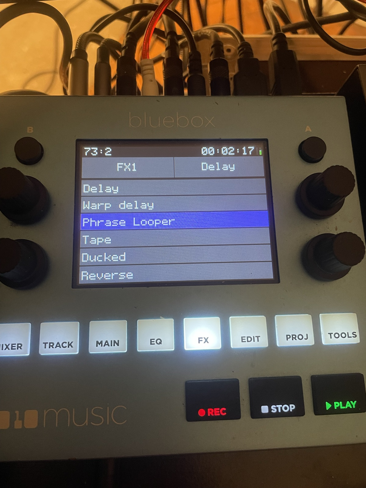

# Cobalt for 1010music bluebox desktop

**v1.2.0 - for bluebox desktop firmware 1.5.2**

Cobalt is an unofficial firmware mod for the bluebox desktop. It adds delay
modes, a new reverb, a per-track noise gate, master saturation, compressor
meters, an overdub recording fix, mixer scenes with MIDI recall, MIDI
controller sync and custom colour themes. The patcher runs locally: it takes your copy of the official
1.5.2 firmware and writes a new `BLUEBOX.BIN`. No firmware is distributed
here.

**Open the patcher: [sbsmnt.github.io/bluebox-cobalt-mod](https://sbsmnt.github.io/bluebox-cobalt-mod/)**

> Cobalt is not made, endorsed or supported by 1010music. Keep a copy of your
> working firmware and back up your projects before installing.

## New in v1.2

- **Phones Src AUTO:** MAIN → B → Phones Src has a third choice, AUTO. The
  phones play the cue mix while any track is cued and the main mix
  otherwise, like PFL on a DJ mixer.
- **Cue icons:** a small headphone marks every cued track on the track
  headers.
- **Unconfigured tracks:** tracks with no input selected are greyed out on
  the track headers.

Thanks to [Milan Wulf](https://github.com/milanwulf) for this feature ([pull request #1](https://github.com/sbsmnt/bluebox-cobalt-mod/pull/1)). Details in [Phones AUTO cue](#phones-auto-cue).

## New in v1.1

- **Scenes:** up to 16 snapshots per project of the mixer, master and aux
  buses, FX1/FX2 (including the effect type) and BPM. Recall is instant,
  with no project load, so playback and recording carry on.
- **Scene page:** select a project in PROJ and press A to load or save a
  scene and set the project's Bank #.
- **Quick save:** hold A for 2 s on MAIN to save the next empty scene.
- **MIDI recall:** Program Change recalls a scene; Bank Select loads the
  project with that Bank #. Channel and Bank CC in TOOLS > MIDI Settings.
- **Map CC Sync:** the bluebox sends the values of its mapped CCs to your
  controller on plug-in, project load and scene recall, so LED rings and
  motor faders show the bluebox values.
- **MIDI Out thru:** notes and CC from USB (or USB and MIDI in) are passed to
  the MIDI out.
- **Clock Src:** with clock on more than one input, one of them is followed
  (MIDI In first, or USB first).
- **PROJ list:** the loaded project is marked with `* `, and long names
  scroll.
- **MIXER sends with OUT3:** buttons read `O 2`, `O 3` and `NG` (gate) so
  all seven fit.

Details in [Scenes](#scenes), [MIDI](#midi) and the [CHANGELOG](CHANGELOG.md).

## Install

1. Open the patcher at
   [sbsmnt.github.io/bluebox-cobalt-mod](https://sbsmnt.github.io/bluebox-cobalt-mod/),
   or open `patch_bluebox.html` from this repository in any modern browser.
   Nothing is uploaded; patching happens in the page.
2. Drop the **original official desktop 1.5.2 `BLUEBOX.BIN`** on the drop
   zone (or click to browse). Other versions and already-patched files are
   refused.
3. Pick a theme preset or build your own, then **Verify and prepare
   download**.
4. Install the new `BLUEBOX.BIN` with the usual SD-card procedure.
5. Check that the middle TOOLS field shows **Cblt 1.2**. The official version
   field still shows 1.5.2.

To go back, tick **Restore the original** and choose your Cobalt
`BLUEBOX.BIN`: the page rebuilds the exact official 1.5.2 file.

The same patcher runs from the command line:

```sh
python3 patch_bluebox.py /path/to/BLUEBOX.BIN --check
python3 patch_bluebox.py /path/to/BLUEBOX.BIN --output /path/to/new/BLUEBOX.BIN
python3 patch_bluebox.py /path/to/BLUEBOX.BIN --theme themes/synthwave.json --output /path/to/new/BLUEBOX.BIN
python3 patch_bluebox.py /path/to/cobalt/BLUEBOX.BIN --restore --output /path/to/original/BLUEBOX.BIN
```

## Features

### FX1 delay modes

Open FX1 and press **B** to choose the mode. Each mode shows its own
controls on the FX1 panel; switching modes keeps every mode's settings.

#### Delay

The stock 1.5.2 delay, unchanged and bit-identical. New projects start here.

| Control | What it does |
|---|---|
| Time | Delay time in ms, or a note division (such as 1/4T) when BEAT is on |
| FEEDB | How much of each repeat is fed back (more repeats) |
| FILT | Turns the delay's filter on |
| CUTOF / WIDTH | Filter frequency and width |
| BEAT | Syncs Time to the project tempo |
| PING | Ping-pong repeats between left and right |
| QUAD | The stock quad delay layout |

#### Warp delay (panel title: Warp)

The stock delay with three extra controls:

| Control | What it does |
|---|---|
| Pitch | Shifts every repeat by −12 to +12 semitones (the toggle turns it on), so repeats climb or fall in pitch as they feed back |
| Drift | Tape-style wow: a slow 0.6 Hz wobble plus a random wander, up to about ±2.5 % pitch at full |
| To Rev | Sends the repeats into FX2, so the echoes are reverberated |

#### Granulr (Granular)

Records the last 2 seconds into a buffer and replays it as up to four
overlapping grains. When fully wet, the stock delay engine is paused to save
CPU.

| Control | What it does |
|---|---|
| Position | How far back in the 2-second buffer grains start: 0 % is the most recent audio, 100 % the oldest |
| Size ms | Grain length, 20–250 ms |
| Density | How many grains overlap, 1–4 (more is smoother and denser) |
| Pitch | Grain pitch, −12 to +12 semitones |
| Jitter | Randomises each grain's start position around Position |
| Feedback | Feeds grains back into the buffer (up to 95 %) for evolving clouds |
| To Rev | Send to the FX2 reverb |
| Freeze | Stops recording: grains keep playing from what is already in the buffer |
| Reverse | Grains play backwards |

With jitter or pitch the grains are mixed by power, so jittered settings stay
as loud as plain ones.

#### Tape

A tape echo: every repeat passes through saturation and filters inside the
feedback loop, so repeats get darker, thinner and more driven as they decay.

| Control | What it does |
|---|---|
| Time / FEEDB | Delay time and feedback, as on Delay |
| Drift | Wow and flutter, as on Warp |
| Drive | Saturation of each repeat (takes WIDTH's place). Quiet tails are not boosted, so drive adds grit without runaway feedback |
| Lo C | Low cut inside the loop: each repeat loses a little more low end. 20 Hz is Off |
| Hi C | High cut inside the loop, 500 Hz–16 kHz: each repeat gets a little darker |
| To Rev | Send to the FX2 reverb |
| BEAT / PING / QUAD | As on Delay |
| WILD | Adds pre-drive damping and extra regeneration in the loop, for a less polite, more unstable echo |

Tape bypasses the stock filter (no FILT), and your FILT setting is kept for
the other modes.

#### Ducked

A delay whose repeats duck while you play and swell back in the gaps.

| Control | What it does |
|---|---|
| Duck | How much the repeats are turned down while the FX1 input is loud (takes WIDTH's place) |
| Release ms | How quickly the repeats come back after the input stops, 20–2000 ms (takes Drift's place) |
| Pitch / To Rev | As on Warp |
| Time / FEEDB / FILT / CUTOF / BEAT / PING / QUAD | As on Delay |

Only what you hear is ducked: the feedback loop keeps running underneath, so
the echoes are all there when they swell back.

#### Reverse

Plays the input backwards in overlapping segments.

| Control | What it does |
|---|---|
| Segment ms | Length of each reversed slice, 40–600 ms (a note division when BEAT is on) |
| Feedback | Feeds reversed audio back for repeated reverse echoes |
| Tone | Low-pass on the reversed sound, from dark (200 Hz) to open (10 kHz) |
| Pitch | −12 to +12 semitones |
| To Rev | Send to the FX2 reverb |
| BEAT | Syncs Segment to the project tempo |

### FX2 Gazer reverb

FX2 → B → **Gazer**: a large, modulated shoegaze reverb with a fuzz stage in
front.

| Control | What it does |
|---|---|
| Saturate | Fuzz before the reverb: clean at 0, about 7 dB of drive at 35 %, pedal-style fuzz at the top. Output level stays constant |
| Size | Room size and decay, from about 3 s to about 40 s |
| Diffusion | How much the sound is smeared before it enters the reverb; higher is smoother |
| Mod Depth | Pitch modulation of the reverb tail (chorus-like shimmer) |
| Rate mHz | Modulation speed, 10–2000 mHz (0.01–2 Hz) |
| Hi C / Lo C | High and low cut on the sound going into the reverb |

### Noise gate

A gate on every track. Set it on TRACK (GATE knob) or in MIXER → Gate (`NG`
when OUT3 is present). The
threshold runs from −96 dB to −12 dB; the lowest setting is Off. It takes fine
steps when turned slowly and speeds up when spun. MIXER → Gate meters show
the level the gate listens to on the Gate fader's scale, so the meter crosses
the fader exactly when the gate opens.

### Phones AUTO cue

MAIN → B → **Phones Src** has a third choice, **AUTO**, next to CUE and MAIN.
It works like PFL on a DJ mixer: the phones play the cue mix while any track
has its cue on (CUE Style Toggle) or turned up (CUE Style Fader), and the
main mix otherwise. Only the cue setting counts, not whether the track is
playing or has an input, so a cued track that is stopped still gives you its
(silent) cue. After the last cue goes off, the phones return to Main within
0.1 s. CUE Send (Pre/Post Fader) works as before. CUE and MAIN are unchanged.

**Track headers** on every page with the track strip:

- A small headphone icon in the top-right corner marks each track with its
  cue on, in any Phones Src mode. It uses the theme's active button fill
  with a background-colour outline. On narrow headers it can cover the last
  letter of the name.
- Tracks with no input selected are greyed out with a stipple, so
  unconfigured tracks stand out. Tracks with a recorded clip are not greyed.

Both follow the track count, Single/Double Row and renamed tracks.

Thanks to [Milan Wulf](https://github.com/milanwulf) for this feature ([pull request #1](https://github.com/sbsmnt/bluebox-cobalt-mod/pull/1)).

### Master saturation

MAIN → B adds four rows after the compressor:

| Control | What it does |
|---|---|
| Saturate | Amount of saturation on the master. 0 is a true bypass |
| Sat Mode | **Soft** or **Tape** |
| Tape Tone | Tape mode only: the treble roll-off, from darker (about 5 kHz) to brighter (about 18 kHz). Default 50 % is about 11.5 kHz |
| Sat Out | Output level after saturation, −12 to +6 dB, to match levels when comparing. Has no effect while Saturate is 0 |

- **Soft** is a smooth, symmetric saturation (adapted from BlueLex). Drive is
  level-compensated, so turning it up adds harmonics rather than volume.
- **Tape** is a tape-style voicing, not a model of a specific machine. Like
  tape it boosts treble going in and cuts it coming out, so highs saturate
  first. Loud passages also lose a little more treble (the treble roll-off is
  linked across both channels). More Saturate adds a gentle low-end bump. Very
  low frequencies and DC are removed. **Tape Tone** sets where the treble
  starts to roll off. Turn it down for warm, darker tape; turn it up to keep
  the top end open.

### Meters

**CPU load bar.** The thin bar right of the clock shows how busy the audio
engine is. It is green up to 70 %, amber to 90 % and red above. A white mark
shows the recent peak.

**Compressor gain reduction.** When the master compressor is on, Cobalt
shows how much it is turning the level down:

- **Header bar:** the bar just left of the CPU bar. Half height is 10 dB of
  reduction; full height is 40 dB.
- **Thresh row (MAIN → B):** a strip along the bottom of the Thresh row. It
  fills from the left as gain reduction rises. Full width is 40 dB. The three
  scale markers are at **5 dB, 10 dB and 20 dB**.

Both use a square-root scale, so small amounts of compression are easy to
see. They show the larger of the two channels, held over about 20 ms. The
fill colour is set in the theme editor (Compressor GR meter).

### Overdub recording fix

Stock 1.5.2 can stop with an error while overdubbing long takes because the
storage task falls behind. Cobalt converts recorded and played-back audio in
word-sized bursts instead of byte by byte. The audio is bit-identical.

### Scenes

A scene is a snapshot of the mixer (track level, pregain, pan, sends, mute,
solo, compressor, EQ and gate), the master and aux buses, every FX1/FX2
parameter including the effect type, and the BPM. Each project holds up to
16, saved in the project file. Recalling a scene changes only the values
that differ, without loading anything, so playback and recording carry on.

- **Scene page:** select a project in PROJ and press A. Turn to pick a row
  and a number, then press Select:
  - **Load Scene:** recall that scene.
  - **Save Scene:** save the current state to that scene.
  - **Bank #:** give the project a number (None or 1–128) for MIDI Bank
    Select. A number another project has is refused ("BANK n IN USE").
  Press A to leave. PROJ Save also applies the Bank # chosen there.
- **Quick save:** hold A for 2 s on MAIN. A band at the top shows progress,
  then saves the next empty scene. A new project starts at scene 1.
- **MIDI:** Program Change recalls a scene: program 0 (PC 1 on gear that
  counts from 1) is scene 1. Bank Select loads the project with that Bank #
  (value 0 = Bank 1); a Program Change after it waits for the load. TOOLS > **MIDI Settings** (tap it, or press B with it selected;
  B goes back) sets **Bank CC** (MSB - CC 0 or LSB - CC 32) and **PC Ch** (All, None or
  1–16).
- **PROJ list:** the loaded project is marked with `* `, and a long selected
  name scrolls.

### MIDI

Also in TOOLS > **MIDI Settings**:

- **MIDI Out:** what the MIDI out passes on, besides the bluebox's own MIDI
  output. `Default` passes nothing else (stock). `USB Thru` passes the
  messages (notes, CC, …) coming from USB (computer on USB-B, controller on
  USB-A). `All Thru` also passes MIDI in. Channels are kept. Clock and transport are never
  passed on, so a clocked setup never sees a second clock.
- **Map CC Sync:** where the values of the mapped CCs are sent, so a
  controller with LED rings or motor faders (OXI E16, MIDI Fighter Twister,
  Launch Control XL 3, Roto-Control, Faderfox EC4, …) shows them:
  - `Off`: never.
  - `USB` (default): to the controller on USB-A when it is plugged in, after
    a project load and after a scene recall.
  - `USB+MIDI Out`: as USB, plus the MIDI out after a project load or scene
    recall.
  - `MIDI Out`: the MIDI out only, after a project load or scene recall.
  The controller must listen on the channel and CC it sends (the usual
  default). If the values can't get out, a band says `MAP CC SYNC: USB OUT
  STUCK` or `MAP CC SYNC: MIDI OUT STUCK`.
- **Clock Src:** which input is followed when more than one sends clock.
  `MIDI In` (default): MIDI in, then the computer (USB-B), then the USB-A
  controller. `USB`: USB-B, USB-A, then MIDI in. The preferred input takes
  over at once; a lower one only after 300 ms without clock from the current
  one. Start, stop, continue and song position follow the same input. The
  band shows the order when the setting is changed.

### Themes

The patcher page has a theme editor with 18 presets and 22 colours, a live
preview of 27 device screens, hold-to-compare with stock and an RGB565
preview. Themes export and import as JSON (`themes/` holds the presets).

## Building from source

Requirements: Arm GNU Toolchain **13.2.Rel1** (other GCC versions produce
different payloads), Python 3 and the original firmware.

```sh
ARM_CC=/path/to/arm-none-eabi-gcc ARM_OBJCOPY=/path/to/arm-none-eabi-objcopy \
ARM_NM=/path/to/arm-none-eabi-nm sh build.sh /path/to/BLUEBOX.BIN
```

`build.sh` compiles the payloads into `build/` and regenerates
`patch_bluebox.html`, `patch_bluebox.py`, `patch_manifest.json`, `themes/`
and `docs/index.html`.

### Tests

The tests run the real patched firmware routines in the Unicorn emulator,
compile host-side DSP checks with sanitizers, and drive both patchers.

```sh
python3 -m pip install -r tests/requirements.txt
python3 tests/run_checks.py /path/to/BLUEBOX.BIN
```

They need Node.js and a host C compiler; add `--browser` to also run the
Playwright end-to-end test. Regression tests compare against earlier
development builds kept in `tests/references/` (patch data only, no
firmware). The tests cover correctness, not sound or CPU load on the device.

### Continuous integration and GitHub Pages

`.github/workflows/pages.yml` runs on every push and pull request. It checks
that no firmware image is committed, that the Python sources compile, that
the theme presets load, and that `docs/index.html` matches
`patch_bluebox.html`. It also runs the patcher page tests and the sanitized
DSP host tests. The emulator suite needs the original firmware, so run
`tests/run_checks.py` locally before pushing.

Pull requests go to the `dev` branch; `main` only receives tested releases
(see [CONTRIBUTING](CONTRIBUTING.md)). On `main`, the workflow then publishes `docs/` (the self-contained patcher
page) to GitHub Pages at [https://sbsmnt.github.io/bluebox-cobalt-mod/](https://sbsmnt.github.io/bluebox-cobalt-mod/).
Enable it once under **Settings → Pages → Build and
deployment → Source: GitHub Actions**.

## Layout

| Path | Contents |
|---|---|
| `src/` | Payload sources (M7 audio core, M4 UI core) and linker scripts |
| `tools/` | Release builder and patcher templates |
| `tests/` | Emulator, host and patcher tests |
| `themes/` | Theme presets as JSON |
| `docs/` | GitHub Pages copy of the patcher |
| `.github/workflows/` | Checks and Pages deployment |
| `patch_bluebox.html`, `patch_bluebox.py` | Ready-to-use patchers |

## Credits

Cobalt builds on **BlueLex**, the modded firmware for the 1010music Bluebox
Euro by lexnels: https://github.com/lexnels/bluelex-bluebox-euro. The CPU
load indicator, the MAIN → B compressor level and meter approach, the Soft
master saturation, and the delay pitch and send to reverb were adapted from
BlueLex, with every desktop address and hook traced independently.
[NOTICE.md](NOTICE.md) has the full attribution and disclaimer.

See [CHANGELOG.md](CHANGELOG.md) for release notes.
## Phrase Looper firmware (experimental build)

> **Tested on one device only.** The Phrase Looper build has been installed and tried on a single bluebox desktop running firmware 1.5.2. It has not been tested on any other unit. See [Hardware testing](#hardware-testing-one-device) for what was checked. Keep the official firmware so you can go back.

The looper is built as a separate firmware variant. The default build is unchanged: it still reproduces the released Cobalt 1.2.0 image (SHA-256 `c28981e5…`), and `patch_bluebox.html` and `docs/index.html` stay Cobalt-only.

**Looper web patcher: [matewmusic-stack.github.io/Cobalt-Phrase-Looper/looper](https://matewmusic-stack.github.io/Cobalt-Phrase-Looper/looper/)** publishes the current build (default theme SHA-256 `3f14345a…`): locked to the song position, bar-quantized REC, Stretch, tempo measured from the song position (so it follows an external master clock), the loop following the transport, and Echo, the stock FX1 delay played on the loop. This build has been tried on hardware. Drop in the original desktop 1.5.2 `BLUEBOX.BIN`; everything runs locally: the page checks the file, applies the looper patch with your theme, and offers the new `BLUEBOX.BIN`. **Restore** gives back the exact original. `patch_looper.py` does the same from the command line. Neither the stock firmware nor any patched image is included. `LOOPER=1 ./build.sh` does not touch the live page; `LOOPER=1 PUBLISH=1 ./build.sh` replaces `docs/looper/index.html` when a build is ready.

```sh
# Arm GNU Toolchain 13.2.Rel1 on PATH, as for the normal build
LOOPER=1 ./build.sh /path/to/stock/BLUEBOX.BIN   # writes build/BLUEBOX-looper.BIN
```

Host checks for the looper logic (any C compiler):

```sh
cc -std=c11 -O1 -Wall -Wextra -Werror -DPHRASE_LOOPER -Isrc tests/looper_host.c -o build/looper_host -lm && build/looper_host
```

Turn up the FX1 send on the tracks to loop and select **Phrase Looper** in the FX1 mode list (where Granular was). The FX1 title shows the state: `Looper` (empty), `ARMED`, `REC 1/2`, `PLAY`, `DUB` or `STOP`. Once the looper has measured a tempo, the empty title shows it instead, for example `Lp128.0`.

Page layout. The physical knobs turn the knobs of one highlighted group of four list entries; buttons are never on them.

| Left | Knob group 1 | Knob group 2 | Right |
|---|---|---|---|
| REC / OVDUB (top) | Bars, Stretch | Time, Echo | (empty) |
| CLEAR (below) | Level | Feedb, Ping | Sync |

The loop follows the bluebox transport: Stop (the button, or the external master stopping) stops the loop, and Play plays it again in step with the song. There is no on-screen STOP and no Dub knob: they were too easy to hit during a set, and overdubs are layered at full level.

| Control | Kind | What it does |
|---|---|---|
| REC | button | Empty: record (on the next bar line while the sequencer plays); at the end of the bars the loop plays by itself. Recording: end on the next bar line. Once a loop exists the button reads **OVDUB**: overdub on/off (a stopped loop overdubs from the start). |
| CLEAR | button | Empty the loop. |
| Sync | on/off (default off) | On: with the sequencer stopped, REC arms and recording starts when it starts. REC again cancels. Locked while a loop exists: a change is put back at once. |
| Bars | 1 or 2 (default 2) | Loop length in 4/4 bars at the current tempo, measured from the song position, so an external master (e.g. a Blackbox) is followed without setting the bluebox BPM. Before the sequencer has run: the MIDI clock or the project BPM. |
| Level | 0–100 % (default 100 %) | Loop volume on the FX1 return. The return carries only the loop. |
| Stretch | Off / Vari / Keep (default Off) | What the loop does when the tempo changes after recording. Off: keeps its recorded speed. Vari: varispeed, stays in time and the pitch follows the tempo. Keep: stays in time at the same pitch (WSOLA time-stretch). |
| Time | delay time | The stock delay's Time: a note division while Beat Sync is on (default), so the echoes follow the tempo; ms when off. Beat Sync, Filter, Drift etc. come from the Delay page. |
| Feedb | 0–100 % | Stock delay feedback: how many repeats. |
| Echo | 0–100 % (default 0 = off) | How much of the loop goes into the stock delay. The FX1 return carries loop + echoes. Back to 0, the echoes ring out, then the delay is skipped again. |
| Ping | on/off | Stock ping-pong: repeats alternate left and right. |

**Echo.** With Echo above 0 and the looper fully faded in, the stock FX1 delay is no longer skipped: the loop is rendered first, written into the delay's bus at the Echo level, the stock delay body runs on it, and the loop is added back to the echoes. No memory is added (the stock delay's rings already exist; the ring-clear state machine keeps stale audio out when it resumes). Echo is a new parameter, `0x1bc` (`lpecho`), in an empty stock slot. Measured on the firmware in the emulator (`tests/test_looper_echo.py`): a click returns exactly as the stock impulse response; worst block 8.3k instructions with Echo, 15.3k with Echo, Ping and Keep stretch (tested Granular: 14.8k–16.8k).

REC, STOP and CLEAR are pedal-style: the M7 counts a press when a button goes from 0 to 1 in the FX1 event queue, and the M4 sets it back to 0 at once, so the buttons never stay lit. A value seen before the first one, such as a project load, only latches. STOP uses a new FX1 parameter, `0x1ba` (`lpstop`), in an empty stock definition slot; it is no longer on the page (the transport stops the loop).

Auto-mute: while the loop plays, the M4 mutes the tracks whose FX1 send is above 0 and that were not already muted. It uses the same native knob call as Scenes recall, so the Mute buttons, the saved project and the audio engine all follow. Those tracks are unmuted while recording or overdubbing, and on stop, CLEAR or leaving the mode. A track the user unmutes during playback stays unmuted, and tracks the user muted are never touched. The record of muted tracks is cleared at boot and on project or bank loads, without unmuting anything.

How it works: the looper uses the Granular SDRAM buffer, allocated once when FX1 is built and before FX2. Loop audio is stored as 16-bit stereo, scaled so ±2.0 (overdub headroom) fills the range, at 4 bytes per frame. The hardware-tested Granular size (768,000 bytes) therefore holds 4 s: 2 bars at 120 BPM. When more SDRAM is free than that plus a 4 MB reserve, the buffer grows to whatever fits, up to 2 bars at 60 BPM (1,536,000 bytes). Longer loops drop to 1 bar, then to the buffer length. The TOOLS middle field shows the longest loop and the arena space that was free for it at boot, for example `Cblt L4.0s F3.1M`. On the first hardware test the old 32-bit buffer could not get its 7 MB and fell back to 2 s, so 2 bars became 1. The M4 publishes the project BPM (setting `0x85`, plain BPM 40–250), the sequencer state, its mute record and the measured MIDI clock tempo to backup SRAM `0x38800EE0`. The M7 looper state lives at `0x38800EA0`, and its first cache line is cleaned after every block for the M4 (title and auto-mute). FX2 and the bootloader are not patched. Leaving the looper mode empties the loop.

**Sync to the sequencer.** The looper follows the bluebox's song position, the 960-ticks-per-beat count behind the `bar:beat` display. On the M7, each block reads `*(0x3000a894)+0x78b0` (or `+0x78b8`, by the app flag `+0x7408`, as the display does). It keeps its own sample-accurate position from the tempo, pulled 1/8 of the way toward each new value; a jump of more than one beat (start, locate) is taken at once.

- **REC with the sequencer running** waits for the next bar line (ARMED). The take ends on the bar line Bars bars later, so it is exactly that many bars of song time. When the sequencer is stopped, Sync on waits for the start, and Sync off records at once (free). A bar-line wait whose sequencer stops falls back to recording at once. A take started by the sequencer starting begins when the position first moves, up to one block (0.7 ms) after the downbeat.
- **Playback while the sequencer runs** is locked to the song: Off plays 1:1 and restarts on every loop cycle, and Vari and Keep map the whole loop onto the cycle. A free loop locks where it is when the sequencer starts. When the transport stops, the loop stops; when it starts, the loop plays in step with the song.
- **2 bars on the tested 4 s buffer** fit exactly at 120 BPM. A sequencer up to 1% slower ends the take at the buffer, still locked.
- Measured on the firmware in the emulator (`tests/test_looper_sync.py`): with the sequencer 0.5% off the stated tempo, 20 restarts in 20 bars, the worst 0.68 ticks (17 µs) from the bar line. With the position updated only every 3rd block with ±2 ticks of noise, the worst is 0.84 ticks. After a 120 → 128 BPM change, Off restarts within 0.45 ticks of each bar line, and Vari and Keep stay within 23 samples of the song phase. The worst block is 11.9k instructions (the tested Granular: 14.8k+).

**Tempo from the song position.** The tempo the looper uses is measured from the song position itself: at each beat crossing it stores the position and the sample count, and the tempo is ticks ÷ samples over up to the last 7 beats. It therefore follows whatever drives the sequencer, the bluebox's own BPM or an external master, with no need for the project BPM to match. This fixed the first hardware report with a Blackbox as master: after switching from a 126 to a 128 BPM project the loop followed, but the next take needed the bluebox BPM set to 128 by hand. A tempo change settles within about 7 beats. The measured tempo sets the take length, drives the position lock between updates, and is the recorded tempo for Stretch. After the sequencer stops it is kept (an external clock stopping leaves the bluebox BPM where it was) until the stated tempo is changed while stopped; before the sequencer has run, the looper uses the MIDI clock or project BPM below. The M7 publishes it in the looper state's second cache line, also cleaned every block, for the title. Measured on the firmware in the emulator with the bluebox at 126 and the song at 128: 128.02 BPM, the next 2-bar take is 180,000 samples (exactly 2 bars at 128), locked, and lands on the bar lines for 20 bars.

**External MIDI clock.** When the bluebox receives MIDI clock, the looper measures its tempo directly instead of trusting the project BPM. Cobalt's MIDI pump (`mo_next`, in the MIDI timer interrupt) already chooses which input owns clock (Clock Src). Every accepted clock tick (0xF8, 24 per beat) is counted, and every 24th is timestamped with the 1 ms UI clock. The tempo is beats ÷ time over up to the last 8 beats (about 4 s at 120 BPM), in hundredths of a BPM. If a single beat differs by more than 2%, the window restarts, so tempo changes are followed within two beats. The looper uses this tempo for loop length and Stretch whenever it is between 20 and 300 BPM, and falls back to the project BPM 300 ms after the last tick. Measured through the real `mo_next` in the emulator: 100.00 BPM exactly, 128.00 after a change from 100, 98.75 for 98.73, and 120.00 with ±1 ms jitter on every tick. This clock tempo is the fallback before the song position has been measured; while the sequencer runs, the loop is locked to the song position.

**Tempo follow (Stretch).** The loop remembers the BPM it was recorded at, and with Stretch on it follows the current tempo (rate = now ÷ recorded, limited to 0.5–2×). *Vari* reads the loop at that rate with 4-point cubic Hermite interpolation. *Keep* plays 2048-frame (43 ms) Hann grains at normal speed, one every 1024 frames, and starts each grain at the offset (±5 ms) whose start best matches the previous grain's continuation (WSOLA). The search is spread over the blocks between grains, so no block is heavy. Its state (96 bytes, then 128 bytes of sync and tempo state) sits after the loop audio, so the buffer request is 768,224 bytes. The read position is kept as whole samples plus a fraction: a single float position loses up to 0.4% of the rate above 65,536 samples. Measured in the emulator (`tests/test_stretch.py`, 1 bar recorded at 120 BPM, played at 112 and 128 BPM):

| | Off | Vari | Keep |
|---|---|---|---|
| Beat timing | 120 BPM (drifts) | new tempo, within 0.03 % | new tempo; single beats ±5 ms |
| 440 Hz tone at 112 / 128 BPM | 440 / 440 Hz | 410.67 / 469.33 Hz | 440.1 / 439.9 Hz |
| Tone residual | −79 dB | −79 dB | −35 to −39 dB |
| Instructions per block, worst | 3.3k | 6.9k | 9.2k (tested Granular: 14.8k–16.8k) |

At the recorded tempo both modes play the loop unchanged. While stretched, overdubbing layers input at the current read position.

### Hardware testing (one device)

All hardware testing so far was done on **one bluebox desktop** (official firmware 1.5.2), with the current looper image `3f14345a…`, `1438c1ad…` (external tempo), `73d9066f…` (song-position lock), `dc79805d…` (before Stretch) and earlier development builds, clocked by a 1010music Blackbox as master. Results on other units may differ, for example in how much SDRAM is free when FX1 is built.

| | |
|---|---|
|  |  |
| **FX1 menu (B):** Phrase Looper in place of Granular | **Looper page, empty (earlier build):** title `Looper`; Bars, Level and Dub knobs; REC, STOP, CLEAR and Sync |
|  |  |
| **Bars = 1 bar,** title `STOP` | **Bars = 2 bars,** title `STOP`, Sync on |
|  | |
| **TOOLS:** `L4.0s` = 4 s longest loop, `F1…` = about 1 MB arena free when FX1 was built. Known display issue: the readout is too wide for its field, overlapping the storage size on the left and cut off by the version on the right. | |

Confirmed on that unit:

- the looper build installs (hold **A** at power-on) and boots, and the other Cobalt features keep working in normal use;
- FX1 lists Phrase Looper, and the looper page shows its controls and live title;
- tempo: a 1-bar loop at 120 BPM lasts 2 s (earlier build);
- with the sequencer running, REC waits for the bar line, and the loop stays on the beat over many passes (`73d9066f…`);
- with the Blackbox as master clock, the loop follows project changes with slightly different tempos (e.g. 126 → 128), and the looper detects the external tempo and records the next loop in sync without touching the bluebox BPM (`1438c1ad…`);
- version 10 (`3f14345a…`) installed and tested: Echo on the loop, the new page layout and knob groups, transport stop, OVDUB and the Sync lock;
- the free arena when FX1 is built is only about 1 MB, so the looper uses the tested 768,000-byte buffer: 4 s, which is 2 bars at 120 BPM or faster. An earlier 32-bit build fell back to 1 bar for this reason (title `REC 1/1`).

Not yet confirmed on hardware:

- recording 2 bars at 120 BPM with the 16-bit buffer;
- REC, STOP and CLEAR switching themselves off, and auto-mute of the tracks feeding FX1;
- Stretch Vari and Keep by ear;
- a take started by pressing start with Sync on (it begins when the position first moves, up to 0.7 ms after the downbeat);
- CPU load and sound over long sessions.

Keep the stock `BLUEBOX.BIN` at hand before trying it.

### Testing the Phrase Looper in the emulator

The upstream Unicorn suite runs against either build. With `LOOPER=1` it loads `build/BLUEBOX-looper.BIN` (checked against `build/looper_manifest.json`) instead of the Cobalt-only image:

```sh
python3 -m venv .venv && .venv/bin/pip install unicorn==2.1.4 capstone==5.0.9
LOOPER=1 .venv/bin/python tests/test_looper.py /path/to/stock/BLUEBOX.BIN
LOOPER=1 .venv/bin/python tests/test_wild_094.py /path/to/stock/BLUEBOX.BIN
```

`tests/test_looper.py` runs the compiled looper inside the stock native FX1 delay object, with the M4 side on the real parameter tables: construction and SDRAM allocation (roomy, tight and full arenas), pedal presses through the FX1 event queue, record and playback of the 16-bit loop, a read watch (no unrecorded frame is ever read), Level, overdub, STOP and CLEAR, auto-mute and unmute through the native knob call, the button reset, the FX1 title states, Sync driven by the real M4 tempo publisher, BPM, early-closed takes, overdub bounds, a buffer-overrun watch, leaving the mode, the TOOLS capacity readout, and instruction counts relative to the hardware-tested Granular mode. Every other `tests/test_*.py` also runs with `LOOPER=1`. The six Granular-renderer suites report SKIP there, and `test_wild_094.py` checks that Tape, Warp, Ducked, Reverse and Delay match Cobalt v0.9.4. The emulator does not model STM32 timing, the caches shared between the two cores, or sound.
